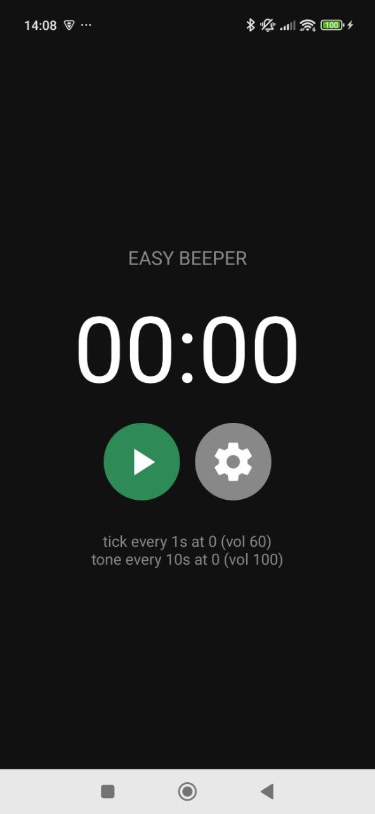
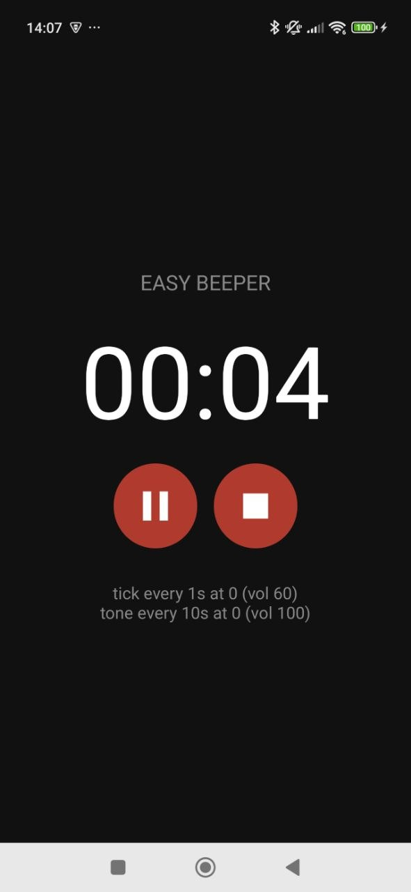
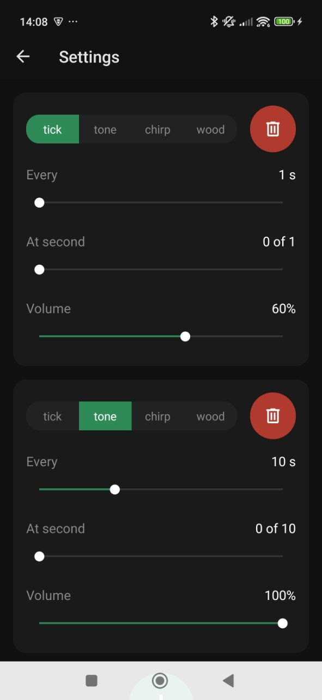

<p align="center">
  
</p>

<h1 align="center">Easy Beeper</h1>

<p align="center">
  A tiny offline interval beeper for Android, written in React Native.<br>
  Beeps every second, a longer tone every ten — and keeps going while you film yourself.
</p>

<p align="center">
  <a href="https://play.google.com/store/apps/details?id=com.raganeta.easybeeper">Google Play</a> ·
  <a href="https://raganeta.com/privacy.html">Privacy policy</a>
</p>

<p align="center">
  
  &nbsp;
  
  &nbsp;
  
</p>

## What it is

I train calisthenics skills — handstands, front levers, static holds — and count them by ear. I wanted a beeper that ticks every second and plays a longer tone every ten, with nothing else: no account, no ads, no subscription, no network. The existing apps had all of those, so this is the simplest thing that does the job.

It was also my first React Native project, so the code is deliberately small and readable. If you're coming to React Native from the web (I came from Vue), it may be a useful end-to-end example: audio, background execution, navigation, persistence, a settings form, and a Play Store release.

## Features

- Any number of beeps, each with its own sound (four built-in, synthesized in code), interval, offset within the interval, and volume.
- Default: a tick every second and a tone every ten.
- Play / pause / stop with a stopwatch display.
- Keeps beeping in the background — switch to the camera app and the beeps are recorded into your video.
- Settings persist locally. Nothing leaves the device.

## How it works

The interesting part is how the beeps are produced. A naïve implementation would run a JavaScript timer and play a short sound on every tick — which drifts, jitters, and gets killed the moment Android decides a background app has had enough CPU.

Instead, the app **renders the whole beep schedule into a WAV file** and plays it in a loop:

1. `src/synth.ts` synthesizes the four sounds as PCM samples (sine, chirp, decaying "woodblock").
2. `src/render.ts` takes the beep configuration, computes a track length that is a multiple of every interval (so the loop point stays aligned), mixes every beep into a 16-bit mono 8 kHz buffer, and writes a WAV header.
3. `src/useBeeper.ts` writes the file to the cache directory and hands it to [`expo-audio`](https://docs.expo.dev/versions/latest/sdk/audio/) with `loop = true`, background playback enabled and lock-screen controls active — which on Android starts a foreground service with a media notification.

From then on the audio hardware does the timing. JavaScript is idle while the beeper runs, so there is nothing for the OS to throttle. The on-screen counter is derived from the wall clock, not from a timer chain.

For the default pattern the rendered track is 5 minutes (4.8 MB) and takes a few milliseconds to generate.

## Stack

- [Expo](https://expo.dev) SDK 57, React Native 0.86, TypeScript
- `expo-audio` for playback and the foreground service, `expo-file-system` for the rendered track
- `expo-sqlite/kv-store` for settings, validated with [Zod](https://zod.dev) schemas (the schema is the single source of truth for the data model)
- [React Navigation](https://reactnavigation.org) v7 (static API) for the two screens
- `@react-native-community/slider`, `@expo/vector-icons`
- Builds and signing via [EAS Build](https://docs.expo.dev/build/introduction/)

## Project layout

```
App.tsx                      providers + navigator
src/
  model.ts                   Beep schema, defaults
  synth.ts                   the four sounds
  render.ts                  config → PCM → WAV
  useBeeper.ts               play / pause / stop, foreground playback
  useTimer.ts                wall-clock ticker for the display
  preview.ts                 one-beep preview when picking a sound
  settings.ts                Settings schema, load/save
  settingsContext.tsx        persisted settings (provide/inject)
  beeperContext.tsx          runtime beeper state
  navigation.tsx, types.d.ts React Navigation setup and typing
  theme.ts                   design tokens
  components/                IconButton, SegmentedButtons, LabeledSlider, BeepCard
  screens/                   MainScreen, SettingsScreen
store/                       icon generator (make_icons.py), Play Store graphics, screenshots
```

## Running it

You need Node.js, Android Studio (SDK + platform tools), JDK 17, and a phone with USB debugging. The app uses native modules, so it does not run in Expo Go; `expo run:android` builds a development client.

```bash
npm install
npx expo run:android      # first run: generates android/, builds, installs on the connected phone
```

After the first build, JavaScript changes hot-reload through Metro; only native changes (adding a native module, editing `app.json` plugins) need another `expo run:android`.

Release builds go through EAS:

```bash
npm install -g eas-cli
eas login
eas build -p android --profile production   # produces an .aab for Google Play
```

## Notes for your phone

- Android 13+ asks for notification permission; the media notification is what keeps the beeper alive in the background, so allow it.
- On Xiaomi/HyperOS set the app's battery saver to **No restrictions** and allow **Autostart**, otherwise the system may kill the playback service after a few minutes.
- To hear the beeps in a recording, your camera app must not mute other audio. On Xiaomi this is the **Multiple audio sources** toggle in the camera settings.

## License

MIT — see [LICENSE](LICENSE).
